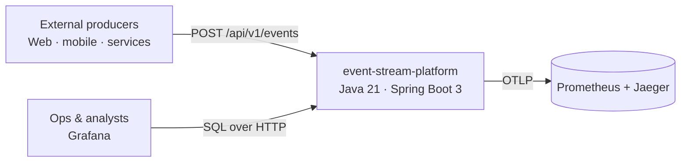
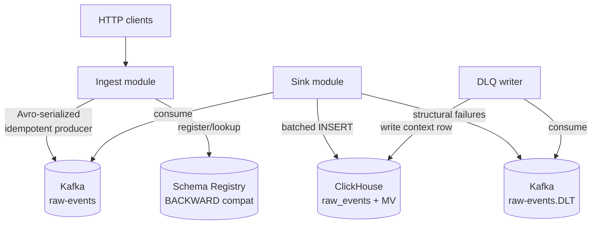
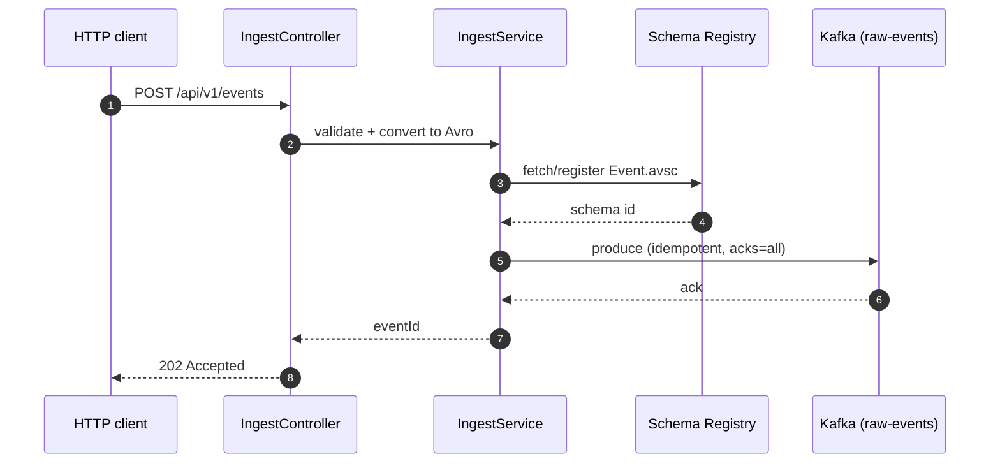
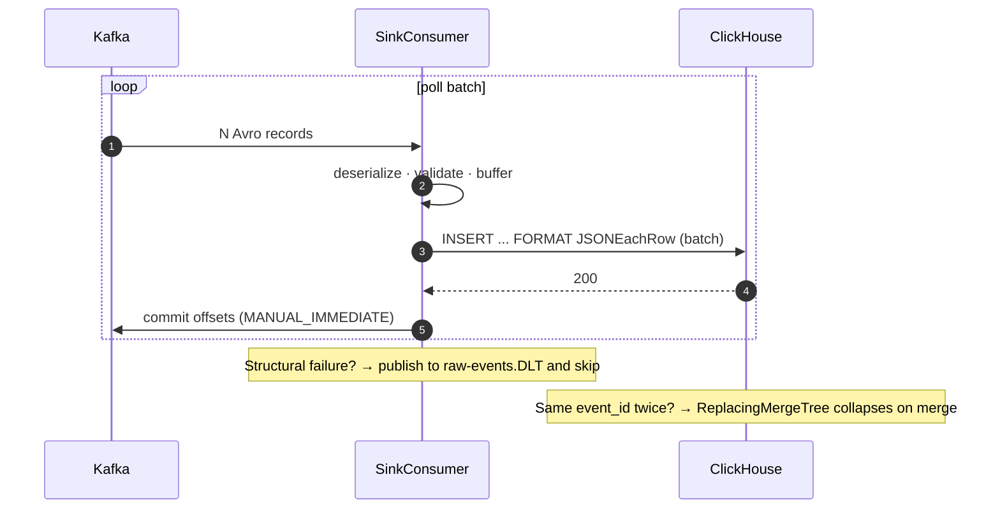

# Architecture

## C4 — Level 1: System Context

## C4 — Level 2: Containers

## Ingest flow

## Sink flow

## Consistency model

- **At the wire** — at-least-once. Producer retries under idempotence + consumer replays after crash.
- **At ClickHouse** — effectively exactly-once by construction (dedup on `event_id` via `ReplacingMergeTree`). Queries against the materialized view are always aggregated and never observe duplicates.
- **DLQ** — the offset advances on structural failure, so a poison message cannot stall the pipeline.

## Backpressure

- The Kafka producer runs off the request thread, but the `send().get(2s)` await gives us bounded latency and forces a 5xx if the broker is unhealthy — the client stops flooding.
- The sink consumer uses `max.poll.records=500` and manual commit. It cannot outpace ClickHouse's insert rate — the next poll blocks until the previous batch is fully committed.
